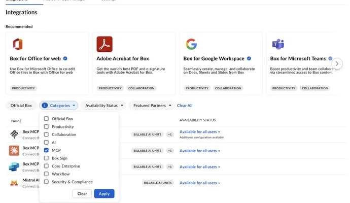

# Box MCP setup draft

**Draft only.** Box's [official setup guide](https://developer.box.com/guides/box-mcp/setup) and [admin guidance](https://support.box.com/hc/en-us/articles/43847256139923-Managing-Box-MCP-Servers) require an OAuth client ID, secret, and registered redirect URI. Box MCP does **not** support dynamic client registration. PR #21's `signin.client: automatic` therefore cannot complete the documented setup as written.

## Admin preparation

1. In the Box Admin Console, open **Integrations** and find the MCP integration entries. Confirm the intended integration is available to the users who need it.

   

2. Register an OAuth app for Kaliper, or confirm whether a centrally distributed Kaliper app can be approved. Configure the exact Kaliper callback URL, client ID, and secret in a secure web flow.
3. Grant only the Box scopes needed to search, list, and read the intended files.

## Customer connection after the app flow exists

1. Choose **Sign in with Box** in Kaliper and approve the Box OAuth request.
2. Use **Test connection** to find a known file, then **Save and turn on**.

The image is a focused crop of Box's public documentation screenshot, not a Kaliper session. Capture the real app-registration and authorization screens and have a second person complete a fresh-account run before adding `connection.guide`.
