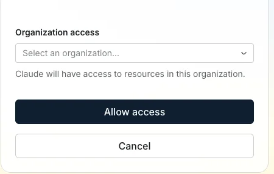

# Clarify setup reference

**Draft reference, not a tested catalog guide.** This focused authorization example comes from [Clarify's public MCP help page](https://docs.clarify.ai/en/articles/13367278-clarify-mcp#h_claude_step2), reviewed 2026-11-09. It is a **Claude** authorization example, not a Kaliper OAuth screenshot.

Choose the organization to authorize, then choose **Allow access**. The actual Kaliper authorization prompt must be checked separately.

## Proposed customer path

1. Confirm which Clarify organization should be connected and that your user can read its records.
2. In Kaliper, add Clarify and choose **Sign in with Clarify**.
3. On Clarify's authorization page, choose the intended organization and approve access.
4. Use **Test connection**, look up a known record, then **Save and turn on**.

Capture the actual Kaliper-to-Clarify OAuth prompt, verify organization selection and read access, and have a second person complete the flow before adding `connection.guide`.
