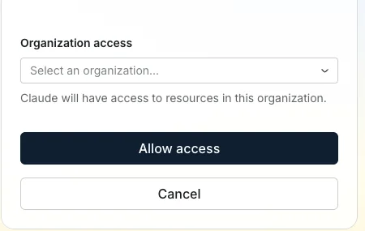

# Clarify setup reference

**Draft reference, not a tested catalog guide.** This focused authorization example comes from [Clarify's public MCP help page](https://docs.clarify.ai/en/articles/13367278-clarify-mcp#h_claude_step2), reviewed 2026-11-09. It is a **Claude** authorization example, not a Kaliper OAuth screenshot.

Choose the organization to authorize, then choose **Allow access**. The actual Kaliper authorization prompt must be checked separately.

## Proposed customer path

1. Confirm which Clarify organization should be connected and that your user can read its records.
2. In Kaliper, add Clarify and choose **Sign in with Clarify**.
3. On Clarify's authorization page, choose the intended organization and approve access.
4. Use **Test connection**, look up a known record, then **Save and turn on**.

Capture the actual Kaliper-to-Clarify OAuth prompt, verify organization selection and read access, and have a second person complete the flow before adding `connection.guide`.

## Authentication check before publication

[Clarify's developer guide](https://developer.clarify.ai/docs/getting-started/ai-agents) describes two MCP authentication paths at `https://api.clarify.ai/mcp`: a **Personal API key** sent as `Authorization: api-key <key>` together with `X-Clarify-Workspace: <slug>`, and **OAuth 2.0 for partner integrations**. The [Clarify MCP help page](https://docs.clarify.ai/en/articles/13367278-clarify-mcp) also describes interactive OAuth for named clients. The current [Kaliper catalog](../catalog-1.0.0.json) declares automatic OAuth and has no API-key or workspace-slug form fields. Verify that Kaliper can complete Clarify's OAuth partner flow before using this guide as customer onboarding. Do not tell users to paste a Personal API key into Slack or the current OAuth screen. If OAuth is unavailable for Kaliper, a separately reviewed connector or catalog version must securely collect both required headers.

Clarify's skill and CLI instructions are for coding agents and are not prerequisites for the hosted Kaliper MCP connection. This guide remains unchecked pending an authenticated Kaliper test and a second-person walkthrough.
