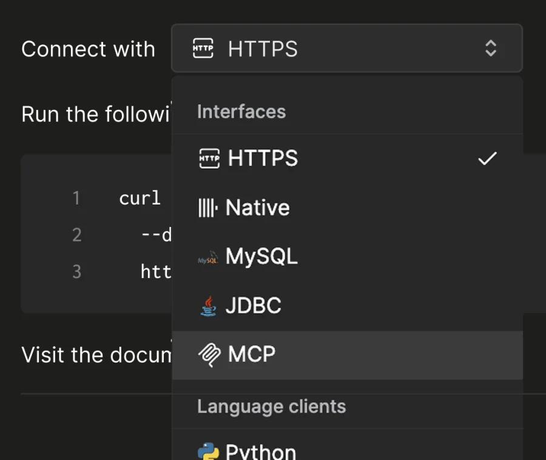
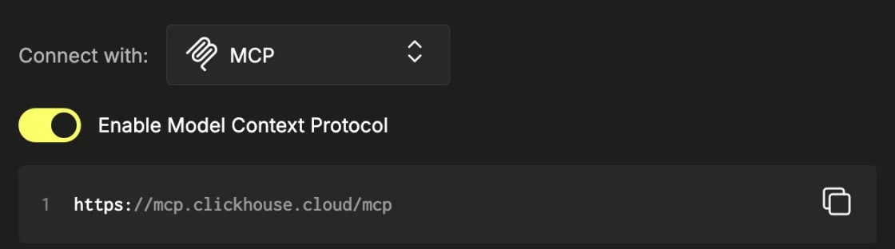

# Connect ClickHouse Cloud to Kaliper (draft)

**Status:** Service enablement was inspected on a demo account on 17 November 2026. A complete Kaliper OAuth connection, harmless read, same-run screenshots, and second-person check are pending. This README is a setup draft, not a checked `connection.guide` in the catalog.

## What you need

- A running [ClickHouse Cloud service](https://console.clickhouse.cloud/) containing data the connecting user may read.
- An administrator with `control-plane:service:manage-mcp` permission to enable Remote MCP for that service.
- A ClickHouse user with access to the service and read access through the SQL Console.

The current [ClickHouse catalog](../catalog-1.0.0.json) uses browser OAuth (`connection.method: signin`) at the fixed vendor endpoint `https://mcp.clickhouse.cloud/mcp`. **You do not need an API key for this Kaliper sign-in path.** ClickHouse's [remote MCP guide](https://clickhouse.com/docs/products/cloud/features/ai-ml/mcp/remote-mcp) documents OAuth and a separate headless API-key path.

## Enable Remote MCP for the service

1. Sign in to [ClickHouse Cloud](https://console.clickhouse.cloud/) and open the intended running service. If it is still provisioning, wait until it is ready.
2. Select **Connect**, then choose **MCP** in **Connect with**. The displayed endpoint should be `https://mcp.clickhouse.cloud/mcp`.

   

3. Switch on **Enable Model Context Protocol**. Ask an administrator if the switch is unavailable. Enable it only on the service intended for this connection.

   

These two images are vendor documentation examples. Replace them with focused, masked screenshots from the same test-account run before this becomes a checked guide.

## Connect in Kaliper with OAuth

4. In the Kaliper test catalog, choose **ClickHouse Cloud** and **Sign in with ClickHouse Cloud**. Use the account that can read the intended service. Capture the Kaliper sign-in control and the ClickHouse consent screen without account IDs or private data.
5. Complete browser authorization. Check the selected organization and service before returning to Kaliper. Do not enter a ClickHouse API key in Slack.
6. Select **Test connection**. List accessible organizations and services, then databases or tables in the demo service. Use a harmless `SELECT` only if a demo table exists. The catalog exposes `get_organizations`, `get_services_list`, `list_databases`, `list_tables`, and `run_select_query`; it exposes no write tool.
7. Select **Save and turn on** after the read succeeds. Capture the test and saved-connection screens.

OAuth uses the signed-in user's SQL Console access. The generic Query API endpoint below is for the API-key path, not a prerequisite for Kaliper's OAuth connection. [ClickHouse documents this distinction](https://clickhouse.com/docs/products/cloud/features/ai-ml/mcp/remote-mcp#authenticate-from-a-headless-environment).

## Optional: a separate headless API-key connection

Use this only for a headless MCP client that cannot complete browser OAuth. **The current Kaliper catalog cannot collect these credentials or create this connection.** These commands are not steps in Kaliper's sign-in flow.

1. In **Organization → API Keys**, create a key with the minimum organization and service permissions. To create one with ClickHouse's CLI, first authenticate `clickhousectl` using an existing key authorized to create keys. Then list roles and create an IP-restricted key:

   ```bash
   clickhousectl cloud org role list
   clickhousectl cloud key create --name mcp-headless --role-id <role_id> --ip-allow <host_ip>/32
   ```

   Replace the placeholders locally. `<host_ip>` is the public egress IP of the headless MCP client. The new key ID and secret are shown once; store them in a secret manager. An empty IP allowlist denies access.
2. For each service the key will query, open **Settings → Query API Endpoints** when the service is awake. Turn on **Allow use of Query API Endpoints**. Create or edit the **generic Query API Endpoint**, allow this same API key, and choose a database role with read access to the intended data. This binding is required for API-key calls to `list_databases`, `list_tables`, and `run_select_query`.
3. Configure the headless client to send HTTP Basic authorization built from the key ID and secret, using its secret manager. Keep both values and the encoded header out of source control, screenshots, and Slack. Base64 is an encoding, not encryption. Follow the [vendor's client-specific header examples](https://clickhouse.com/docs/products/cloud/features/ai-ml/mcp/remote-mcp#authenticate-from-a-headless-environment).
4. Test service discovery, then a database listing and a harmless SELECT against demo data. If service discovery works but query tools fail, check that the generic endpoint includes the same API key and read-only database role.

## Screenshot and review checklist

- [ ] Replace `01-select-mcp.webp` and `02-enable-mcp.webp` with same-run test-account captures.
- [ ] Capture `03-kaliper-signin.webp`, `04-clickhouse-oauth.webp`, `05-kaliper-test.webp`, and `06-kaliper-save.webp`.
- [ ] Mask service IDs, organization IDs, user details, keys, and private data. Crop each image to its control, add one orange outline, and export WebP at no more than 512 KB.
- [ ] Compare authenticated `tools/list` with the five catalog tools and run a harmless read.
- [ ] Have a second person follow the OAuth steps on a fresh account. Only then add `connection.guide`, run `uv run catalog guide-images`, and set `checked` to the walkthrough date.

Source: [ClickHouse Cloud Remote MCP documentation](https://clickhouse.com/docs/products/cloud/features/ai-ml/mcp/remote-mcp).
