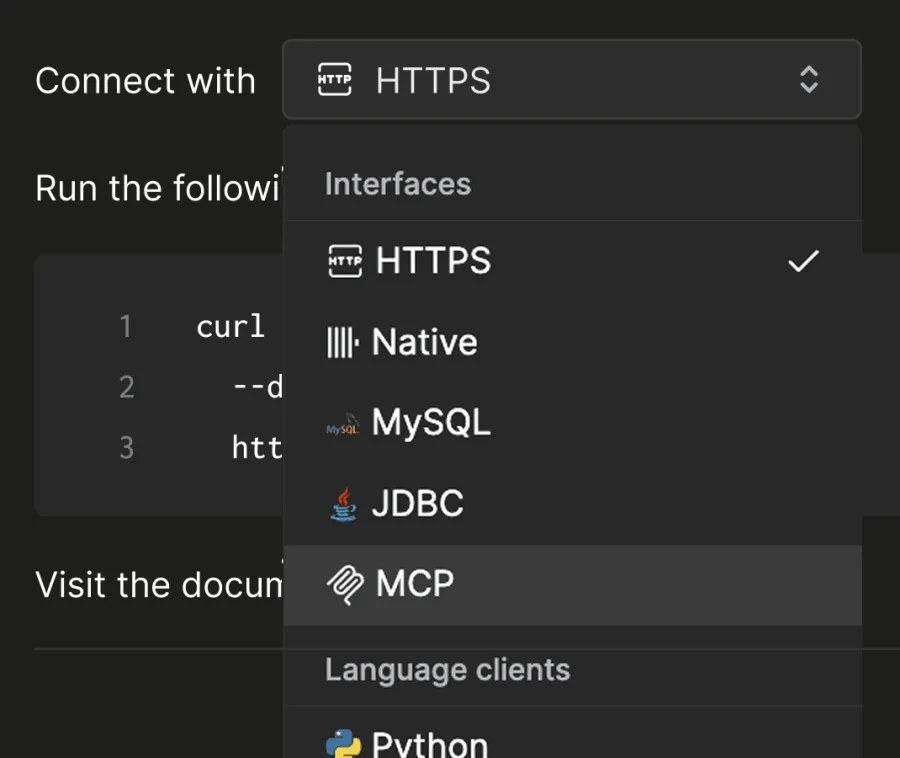
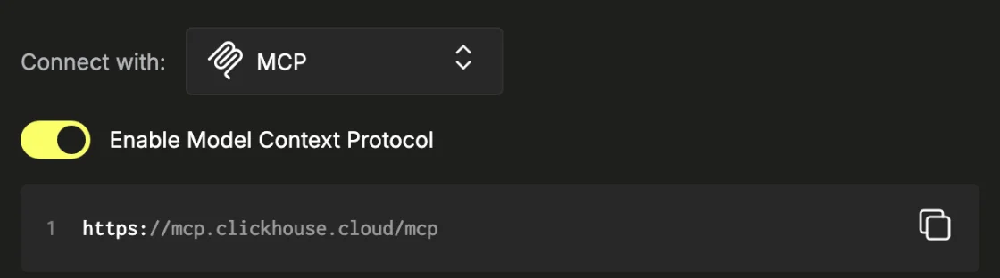

# ClickHouse Cloud setup reference

**Draft reference, not a tested catalog guide.** These focused screenshots come from [ClickHouse's public Remote MCP documentation](https://clickhouse.com/docs/products/cloud/features/ai-ml/mcp/remote-mcp#enable-remote-mcp-server), reviewed 2026-11-09. They show the vendor's example service, not a Kaliper-connected account.

1. Select **MCP** in the service's **Connect with** menu.

   

2. Turn on **Enable Model Context Protocol** for the service.

   

## Proposed customer path

1. Ask a ClickHouse service admin to open the intended running Cloud service and enable Remote MCP under **Connect → Connect with MCP**. The admin needs permission to manage MCP for that service.
2. In Kaliper, add ClickHouse Cloud and choose **Sign in with ClickHouse Cloud**.
3. Approve access with the ClickHouse user who can see that service.
4. Use **Test connection**, ask for accessible services and databases, then **Save and turn on**.

Before adding `connection.guide`, capture the actual admin and OAuth screens on a fresh account, verify the resulting tools, and have a second person complete this path. Replace these documentation examples with screenshots from that run.
