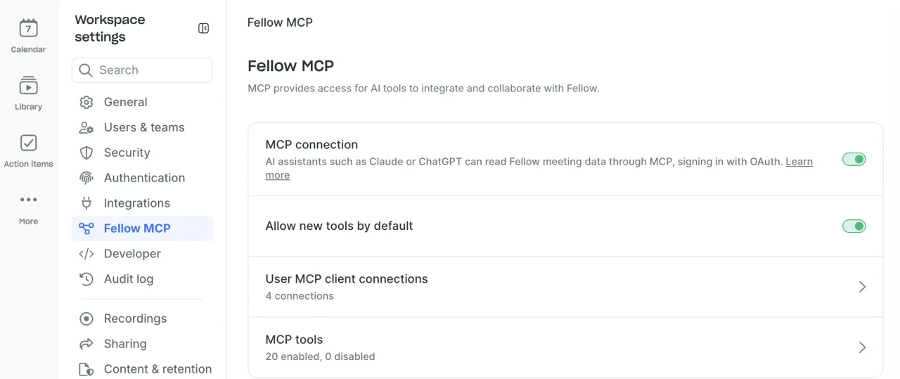
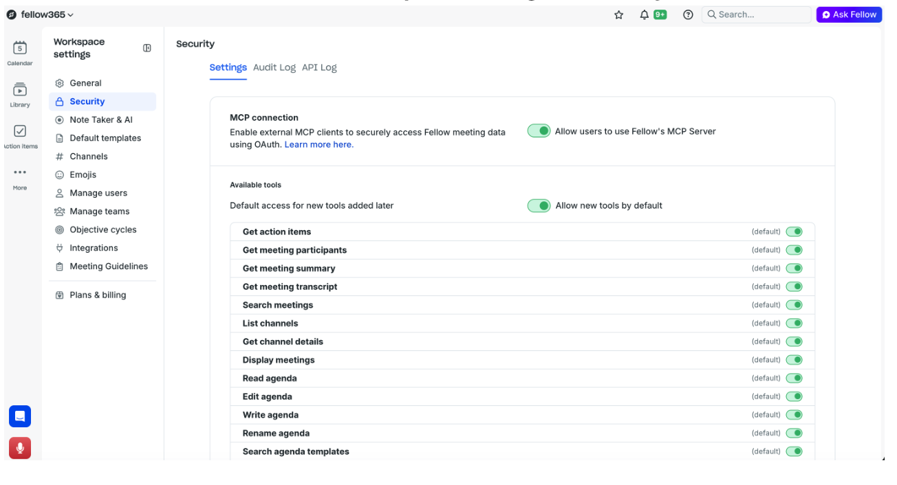
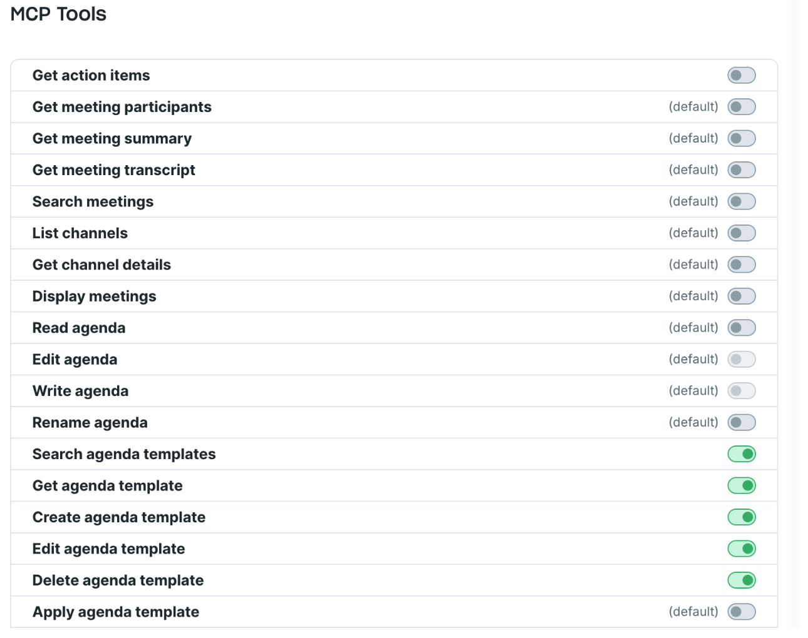
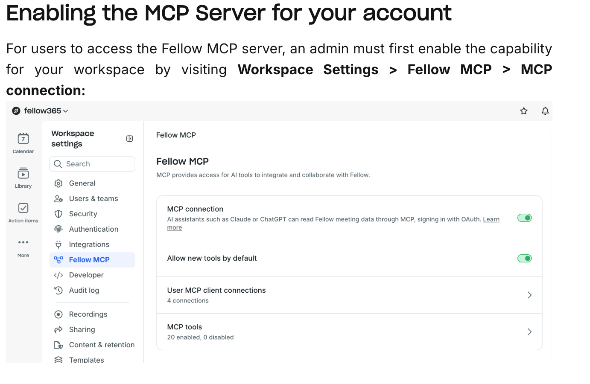

# Fellow setup reference

**Draft reference, not a tested catalog guide.** This focused settings image comes from [Fellow's public MCP help page](https://help.fellow.ai/en/articles/12622641-fellow-s-mcp-server#h_932a3d9dac), reviewed 2026-11-09. It is a vendor example, not a Kaliper-connected workspace.

Turn on **MCP connection** under **Workspace Settings → Fellow MCP**.

## Proposed customer path

1. Ask a workspace admin to open **Workspace Settings → Fellow MCP → MCP connection** and enable it.
2. In Kaliper, add Fellow and choose **Sign in with Fellow** using an account that can see the intended meetings.
3. Approve Fellow's authorization prompt.
4. Use **Test connection**, search for a known meeting, then **Save and turn on**.

Fellow also offers workspace tool controls. Confirm the exact labels, OAuth prompt, and meeting visibility on a fresh account; have a second person repeat the steps before adding `connection.guide`.

## Screens supplied for review

These three images were supplied on 17 November 2026. They show the vendor interface and documentation, but they do not establish a completed Kaliper connection. They are kept as references until a fresh-account walkthrough produces focused, masked WebP captures and a second person checks the flow.

The images show two navigation layouts: **Workspace Settings → Security → MCP connection** and **Workspace Settings → Fellow MCP → MCP connection**. Use the path visible in the test workspace and verify it during the walkthrough. The supplied tool screenshot also shows **Allow new tools by default** and several write tools enabled. For a read-only Kaliper connection, turn off automatic access for new tools and enable only the read tools exposed by the catalog. Do not enable agenda or template creation, editing, or deletion for this guide. Check the exact tool labels and permissions against the live Fellow workspace before marking the guide checked.
