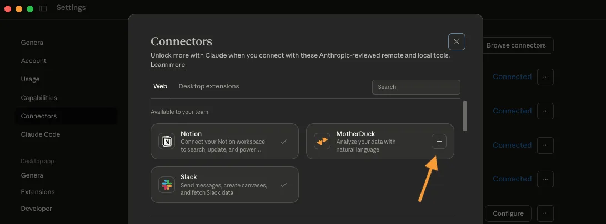

# MotherDuck setup reference

**Draft reference, not a tested catalog guide.** This focused connector image comes from [MotherDuck's published walkthrough](https://motherduck.com/blog/developer-dad-does-disney/), reviewed 2026-11-09. It shows MotherDuck in **Claude's** connector picker, not Kaliper's authorization screen.

The **+** control adds MotherDuck in Claude. In Kaliper, use **Sign in with MotherDuck** instead.

## Proposed customer path

1. Confirm your MotherDuck user can see the database to connect.
2. In Kaliper, add MotherDuck and choose **Sign in with MotherDuck**.
3. Approve the MotherDuck OAuth request for that user.
4. Use **Test connection**, ask for the accessible databases, then **Save and turn on**.

MotherDuck's remote server offers read and write functionality; this catalog only exposes its read tools. Capture the actual OAuth and Kaliper test screens on a fresh account, verify tool restrictions, and have a second person complete the path before publishing a `connection.guide`.
