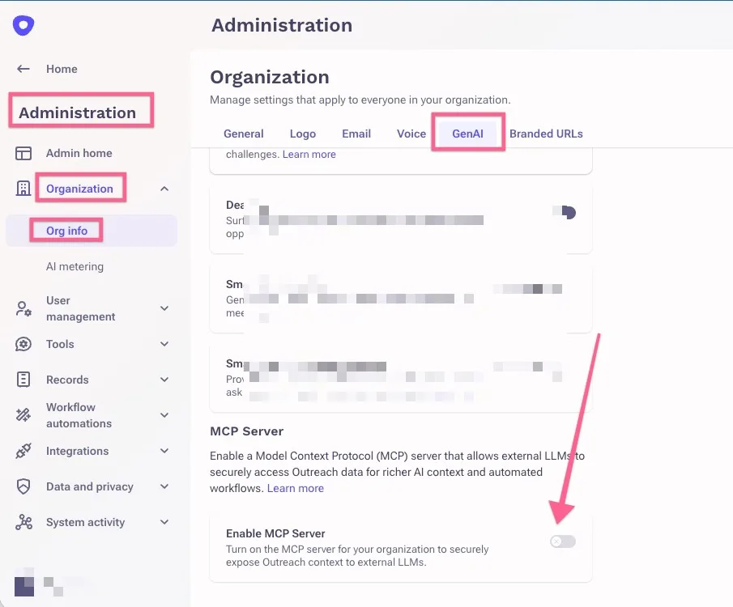
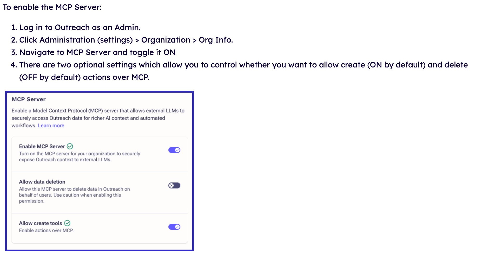

# Outreach setup reference

**Draft reference, not a tested catalog guide.** This focused settings image comes from [Outreach's public MCP support article](https://support.outreach.io/support/solutions/articles/159000429906-why-is-the-mcp-toggle-grayed-out-), reviewed 2026-11-09. It is a vendor example, not a Kaliper-connected organization.

Turn on **Enable MCP Server** under **Administration → Organization → Org info → Gen AI**.

## Proposed customer path

1. Confirm the organization has Amplify access and the connecting user has an active Outreach seat.
2. Ask an Outreach admin to open **Administration → Organization → Org info → Gen AI**, enable **MCP Server**, turn off **Allow create tools**, leave **Allow data deletion** off, and save. Outreach's example has create tools on by default; the current Kaliper catalog exposes read tools only.
3. In Kaliper, add Outreach and choose **Sign in with Outreach**. Approve the OAuth request with a user who can read the intended records.
4. Use **Test connection**, look up a known opportunity, then **Save and turn on**.

Capture the actual toggle and OAuth prompts on a fresh organization, check role-based access, and have a second person complete the path before adding `connection.guide`.

## Screenshot supplied for review

The image below was supplied on 17 November 2026. It shows [Outreach's public setup instructions](https://support.outreach.io/support/solutions/articles/159000425158-outreach-mcp-server), including the MCP settings panel. It is a documentation screenshot, not proof that a Kaliper test organization has enabled MCP. Keep it as a reference until a fresh-account walkthrough produces a focused, masked WebP capture.

In this vendor example, **Allow create tools** is on while **Allow data deletion** is off. The initial Kaliper read-only setup should have both permissions off. Confirm the live control labels and the available tools before marking this guide checked.
